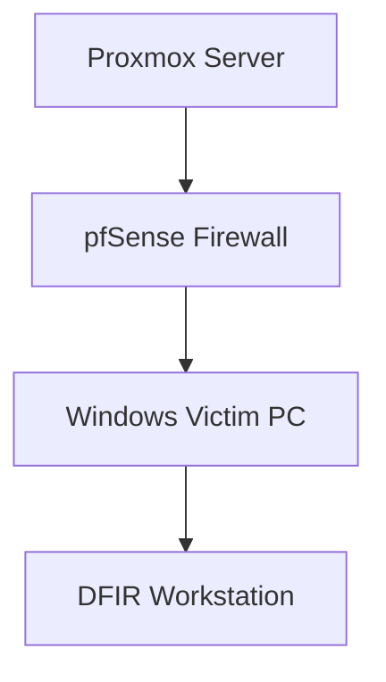

# DFIR Home Lab Architecture

## Overview

This document describes the infrastructure supporting my Digital Forensics and Incident Response (DFIR) home laboratory.

The environment is hosted on a Dell PowerEdge T630 running Proxmox Virtual Environment 9.1.1.

The laboratory is designed to support hands-on training in digital evidence acquisition, Windows forensic analysis, Active Directory investigations, incident reconstruction, and eventually network forensics.

The environment is a work in progress. Virtual machines and services will be developed as new investigative exercises are introduced.

## Lab Architecture Diagram

**Diagram note:** This is a conceptual overview of the laboratory and its planned investigative workflows. Arrows do not necessarily represent currently verified network connections. Actual connectivity, routing, and network isolation will be documented separately.

## Physical Infrastructure

| Component | Configuration |
|---|---|
| Server | Dell PowerEdge T630 |
| Virtualization platform | Proxmox VE 9.1.1 |
| Processor | Intel Xeon E5-2630 v3 |
| Physical memory | Approximately 16 GB installed |
| Storage | Proxmox-managed local and ZFS storage |
| Lab firewall | pfSense virtual machine |

Physical memory is currently a limiting resource. The laboratory is operated with selected virtual machines running at a time to reduce resource contention.

Additional memory is planned to support larger investigations and network-monitoring workloads.

## Virtual Machine Inventory

| VM ID | Name | Platform | Purpose |
|---|---|---|---|
| 100 | pfSense | pfSense | Lab firewall and routing |
| 101 | Victim-PC | Windows 11 | Evidence-generation workstation |
| 102 | UbuntuSec | Ubuntu Server | Linux administration, logging, and forensic exercises |
| 104 | Kali | Kali Linux | Authorized security-testing environment |
| 105 | SecOnion | Security Onion | Future network security monitoring |
| 120 | DFIR-Windows | Windows 11 | Forensic acquisition and analysis |
| 200 | DC01 | Windows Server | Active Directory and authentication investigations |

### Current Operational Status

At the time of this documentation:

- Victim-PC and DFIR-Windows are running.
- The other virtual machines are powered off.
- pfSense has been configured for the laboratory network.
- Security Onion has been created but is not yet operational.
- DFIR-Windows has 12 GB of allocated memory.
- Victim-PC has 4 GB of allocated memory.

Virtual machine power states will change depending on the investigation being performed.

## Network Architecture

The laboratory includes a pfSense virtual firewall configured to support lab networking.

Its intended responsibilities include:

- Routing laboratory traffic
- Managing firewall policies
- Supporting network segmentation
- Providing a controlled environment for security testing

The exact network topology, virtual bridges, subnet assignments, and isolation boundaries will be documented after configuration verification.

No production or personal devices will be intentionally targeted during laboratory security simulations.

## Investigative Workflows

### Workflow 1: Windows Forensic Examination

1. Generate authorized activity on Victim-PC.
2. Preserve the relevant evidence.
3. Acquire a forensic copy using an appropriate collection method.
4. Calculate and verify cryptographic hashes.
5. Examine the evidence on DFIR-Windows.
6. Document observations, interpretations, and investigative limitations.

### Workflow 2: Active Directory Investigations

1. Generate controlled authentication and account activity.
2. Collect relevant domain controller and workstation logs.
3. Identify significant security events.
4. Correlate events across systems.
5. Reconstruct the sequence of activity.
6. Produce an investigation report.

### Workflow 3: Network and Host Correlation

**Status: Planned**

Once Security Onion is operational:

1. Generate controlled network activity within an authorized lab.
2. Collect relevant network telemetry.
3. Examine alerts and network connections.
4. Compare network observations with Windows artifacts.
5. Reconstruct an incident timeline.
6. Document supported findings and uncertainties.

## Planned Improvements

- Complete forensic tool configuration on DFIR-Windows.
- Verify and document virtual network topology.
- Establish repeatable evidence acquisition procedures.
- Create forensic investigation templates.
- Expand server memory.
- Complete Security Onion configuration.
- Publish documented forensic case studies.

## Documentation and Evidence Handling

This repository contains educational lab documentation.

Forensic evidence, when generated, will be handled with attention to integrity, repeatability, and traceability.

Public documentation will use sanitized screenshots and synthetic evidence. Credentials, sensitive system information, and personal data will not be published.

---

*Last updated: October 2026*

*Part of the Digital Forensics & Incident Response Home Lab project.*
